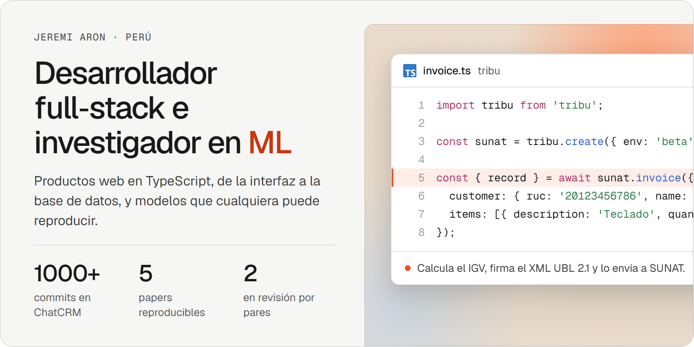
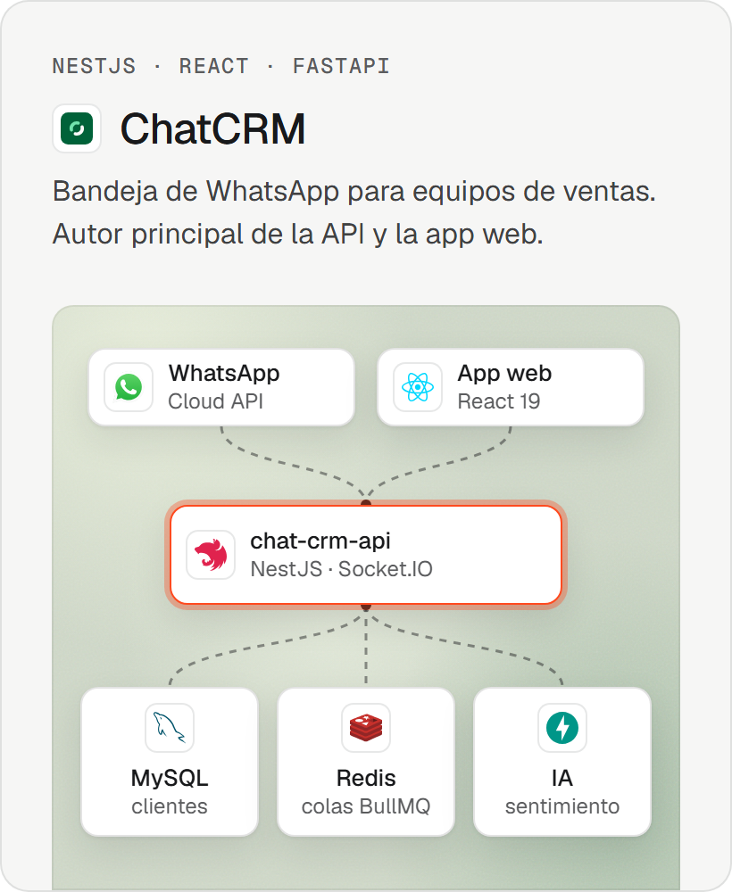
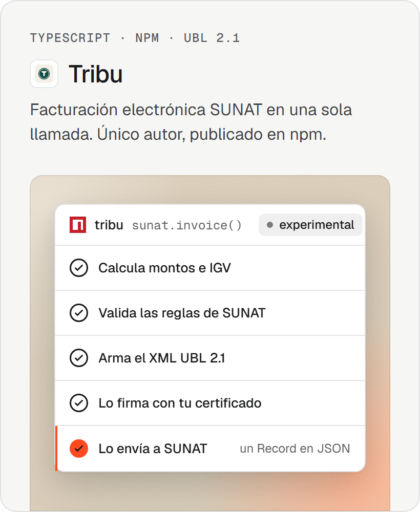
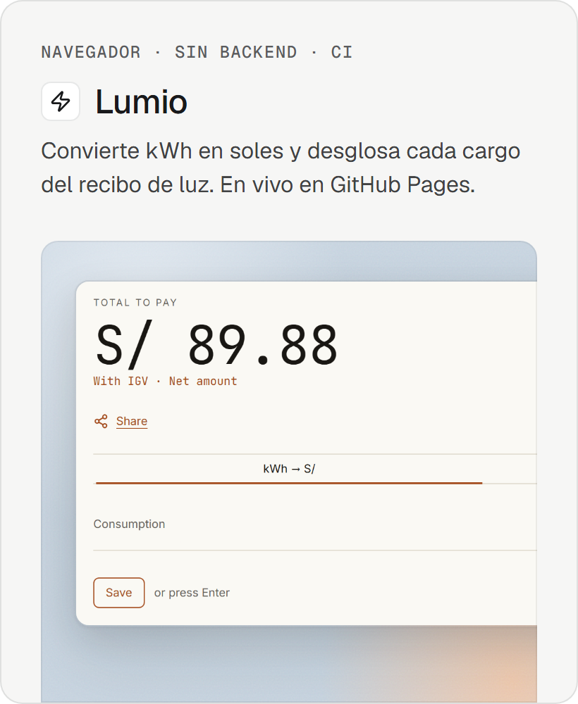
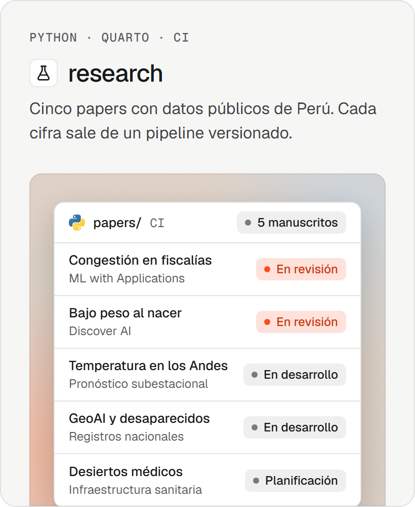

<picture>
  <source media="(prefers-color-scheme: dark)" srcset="assets/hero-dark.png">
  
</picture>

  <picture>
    <source media="(prefers-color-scheme: dark)" srcset="https://readme-typing-svg.demolab.com?font=Geist+Mono&weight=500&size=18&duration=2800&pause=1600&color=FF6A45&center=true&vCenter=true&width=620&height=40&lines=Full-stack%3A+TypeScript%2C+NestJS+y+React;Investigaci%C3%B3n+aplicada+en+machine+learning;Abierto+a+roles+full-stack%2C+backend+e+investigaci%C3%B3n">
    
  </picture>

  
  
  
  

### Proyectos

<a href="https://github.com/chat-crm-suite"><picture><source media="(prefers-color-scheme: dark)" srcset="assets/card-chatcrm-dark.png"></picture></a> <a href="https://github.com/tribu-pe/tribu"><picture><source media="(prefers-color-scheme: dark)" srcset="assets/card-tribu-dark.png"></picture></a>

<a href="https://lisk0vian.github.io/lumio/"><picture><source media="(prefers-color-scheme: dark)" srcset="assets/card-lumio-dark.png"></picture></a> <a href="https://github.com/lisk0vian/research"><picture><source media="(prefers-color-scheme: dark)" srcset="assets/card-research-dark.png"></picture></a>

  ChatCRM: <a href="https://github.com/chat-crm-suite/chat-crm-api">API</a> · <a href="https://github.com/chat-crm-suite/chat-crm-app">App</a> · <a href="https://github.com/chat-crm-suite/chat-crm-ia">IA</a>
  &nbsp;|&nbsp; Tribu: <a href="https://github.com/tribu-pe/tribu">código</a> · <a href="https://www.npmjs.com/package/tribu">npm</a>
  &nbsp;|&nbsp; Lumio: <a href="https://lisk0vian.github.io/lumio/">en vivo</a> · <a href="https://github.com/lisk0vian/lumio">código</a>

### Stack

  <picture>
    <source media="(prefers-color-scheme: dark)" srcset="https://skillicons.dev/icons?i=ts%2Cnodejs%2Cnestjs%2Creact%2Cvite%2Ctailwind%2Castro%2Cmysql%2Credis%2Cpy%2Cfastapi%2Cdocker%2Cgithubactions&theme=dark&perline=13">
    
  </picture>

También: TypeORM, BullMQ, Socket.IO, TanStack Router y Query, pandas, LightGBM y Quarto.

### Cómo trabajo

- Cada número de un paper sale de un pipeline versionado; si no se reproduce, no entra.
- Cada cambio pasa por CI: tests, validación de manuscritos y build.
- Documento las decisiones y el contrato de datos antes de escalar.

<picture>
  <source media="(prefers-color-scheme: dark)" srcset="https://raw.githubusercontent.com/lisk0vian/lisk0vian/output/snake-dark.svg">
  
</picture>

English version

### Full-stack developer and ML researcher, based in Peru

I build complete web products in TypeScript, from the interface to the database, and machine learning models that anyone can reproduce. Looking for full-stack, backend, or applied-research roles.

**1,000+ commits on ChatCRM · an SDK published on npm · five manuscripts, two in peer review**

#### ChatCRM: WhatsApp inbox for teams

Every WhatsApp conversation lands in a shared inbox, is assigned to an available agent, and becomes a customer you can measure. I am the main author of the API and the web app: signed WhatsApp Cloud API webhooks, real-time messaging over Socket.IO, queues on BullMQ and Redis, channel credentials encrypted at rest with AES-256-GCM, and Zod schemas shared by the API and the app that also generate the OpenAPI docs. A separate FastAPI service scores the sentiment of Spanish messages.

[API](https://github.com/chat-crm-suite/chat-crm-api) · [App](https://github.com/chat-crm-suite/chat-crm-app) · [AI service](https://github.com/chat-crm-suite/chat-crm-ia)

#### Tribu: SUNAT electronic invoicing for TypeScript

Issues invoices, receipts, and notes to Peru's tax authority in one call: it computes the IGV, checks SUNAT's rules before sending, builds the UBL 2.1 XML, signs it, and sends it. I am its sole author. Experimental release: SUNAT's beta environment accepts every document type it issues.

[Code](https://github.com/tribu-pe/tribu) · [npm](https://www.npmjs.com/package/tribu)

#### Lumio: electricity bill calculator

Turns kWh into soles, breaks down every charge, and compares your usage. It runs entirely in the browser, with no backend and no accounts, and ships through CI to GitHub Pages.

[Open Lumio](https://lisk0vian.github.io/lumio/) · [Code](https://github.com/lisk0vian/lumio)

#### research: reproducible papers on Peruvian public data

Every number in every manuscript comes from a versioned Python pipeline, and CI validates each manuscript before building it. Two papers are being revised after peer review (*Machine Learning with Applications*, *Discover Artificial Intelligence*); two are in progress and one is in planning.

[See research](https://github.com/lisk0vian/research)

#### How I work

- Every number in a paper comes from a versioned pipeline; if it cannot be reproduced, it does not ship.
- Every change goes through CI: tests, manuscript validation, and build.
- I document decisions and the data contract before scaling the code.

