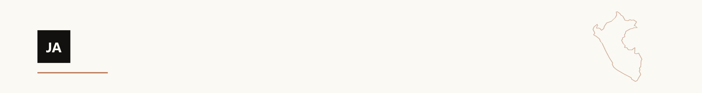
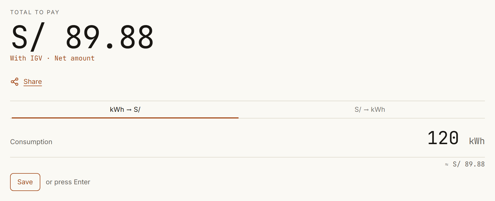

# Desarrollador full-stack e investigador en Perú

Construyo productos web de la interfaz a la base de datos, y modelos que se pueden reproducir. Abierto a roles full-stack y de investigación aplicada.

**5 manuscritos activos, 2 en revisión.**

[Hablemos](mailto:chancanjeremiaron@gmail.com) · [Ver Lumio](https://lisk0vian.github.io/lumio/)

<picture>
  <source media="(prefers-color-scheme: dark)" srcset="assets/cover-dark.png">
  
</picture>

## Trabajo

### Lumio: calculadora de recibo eléctrico

<picture>
  <source media="(prefers-color-scheme: dark)" srcset="assets/lumio-dark.png">
  
</picture>

Convierte kWh en soles, desglosa cargos y compara tu consumo. Corre entera en el navegador, sin backend ni cuentas.

[Abrir Lumio](https://lisk0vian.github.io/lumio/) · [Código](https://github.com/lisk0vian/lumio)

### ChatCRM: bandeja de WhatsApp para equipos

API en NestJS, app en React y análisis de sentimiento en español con FastAPI. Producto de la org ChatCRM.

[Ver ChatCRM](https://github.com/chat-crm-suite)

### research: papers reproducibles

Salud materna, clima andino, congestión procesal, desapariciones y acceso a infraestructura sanitaria. Quarto, Python y CI: cada cifra se regenera desde los datos.

[Ver research](https://github.com/lisk0vian/research)

## Cómo trabajo

- Cada número de un paper sale de un pipeline versionado; si no se reproduce, no entra.
- Cada cambio pasa por CI: tests, validación de manuscritos y build.
- Documento las decisiones y el contrato de datos antes de escalar.

## Herramientas

**Producto**: TypeScript, React, NestJS, MySQL, Redis, Astro
**Investigación**: Python, FastAPI, pandas, LightGBM, Quarto

## Contacto

[Email](mailto:chancanjeremiaron@gmail.com) · [GitHub](https://github.com/lisk0vian) · [X](https://x.com/AronJeremi)

English version

## Full-stack developer and researcher in Peru

I build web products from the interface to the database, and models that can be reproduced. Open to full-stack and applied-research roles.

**Five active manuscripts, two under review.**

[Email me](mailto:chancanjeremiaron@gmail.com) · [See Lumio](https://lisk0vian.github.io/lumio/)

### Work

#### Lumio: electricity bill calculator

Turns kWh into soles, breaks down every charge, and compares your usage. It runs entirely in the browser, with no backend and no accounts.

[Open Lumio](https://lisk0vian.github.io/lumio/) · [Code](https://github.com/lisk0vian/lumio)

#### ChatCRM: WhatsApp inbox for teams

NestJS API, React app, and Spanish sentiment analysis with FastAPI. A product from the ChatCRM org.

[See ChatCRM](https://github.com/chat-crm-suite)

#### research: reproducible papers

Maternal health, Andean climate, prosecutorial congestion, missing persons, and access to healthcare infrastructure. Quarto, Python, and CI: every number is regenerated from the data.

[See research](https://github.com/lisk0vian/research)

### How I work

- Every number in a paper comes from a versioned pipeline; if it cannot be reproduced, it does not ship.
- Every change goes through CI: tests, manuscript validation, and build.
- I document decisions and the data contract before scaling the code.

### Tools

**Product**: TypeScript, React, NestJS, MySQL, Redis, Astro
**Research**: Python, FastAPI, pandas, LightGBM, Quarto

### Contact

[Email](mailto:chancanjeremiaron@gmail.com) · [GitHub](https://github.com/lisk0vian) · [X](https://x.com/AronJeremi)

<!-- Peru outline: Natural Earth 1:110m admin 0 countries, public domain. Cover and share card generated from it. -->

